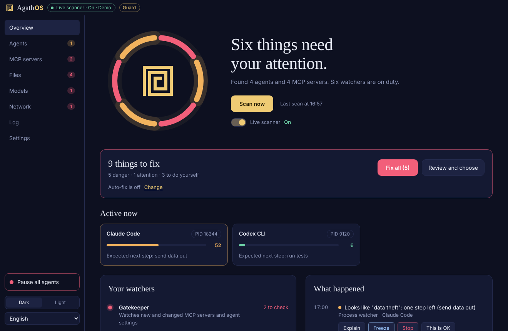
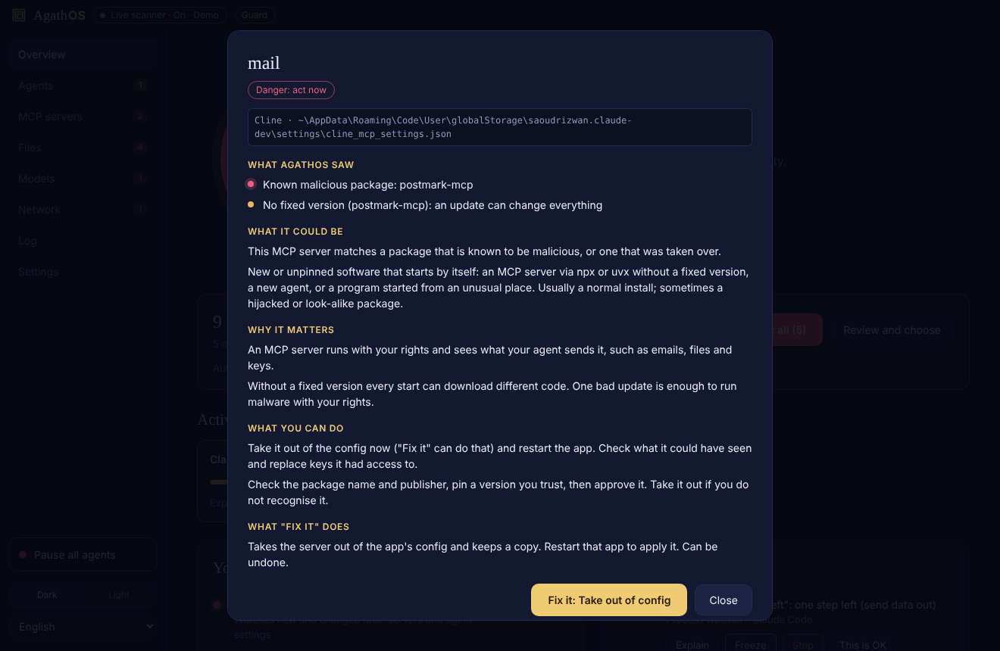

# AgathOS

**The good daemon for your local AI agents.**

The ancient Greeks believed every home had an *Agathos Daimon*: a good spirit that
quietly watched over the house and the people in it. In computing, a *daemon* is a
program that runs in the background. AgathOS is both: a free, open-source Windows app
that keeps watching the AI agents on your PC, warns you before they do damage, and gives
you a real stop button.

Nothing leaves your PC. No account, no cloud, no telemetry.

## Why

In 2025 and 2026 most real harm from AI agents on personal computers did not come from
an AI that "wanted" evil. It came from:

- **poisoned packages, skills and MCP servers** that stole keys and wallets
  (Nx "s1ngularity", Shai-Hulud, `postmark-mcp`, malicious ClawHub skills)
- **agents in "allow everything" mode** that wiped folders or whole drives
- **hidden instructions** in repos, web pages and rules files, including invisible Unicode
- **local AI servers left open** to the network (Ollama on `0.0.0.0:11434`)
- **agents that say "all tests pass"** when they did not

Prompt injection is not solved, and nobody can reliably read an AI's mind. AgathOS does
not pretend otherwise. It makes every AI on your PC visible, scores the risk in plain
words, predicts the next step from the actions it sees, and limits the damage.

## What it does

**Six watchers**

| Watcher | Looks for |
|---|---|
| Gatekeeper | MCP servers in every app's config: known-bad packages, unpinned versions, inline secrets, plain-http servers. Approve a server and AgathOS pins it; any later change (a "rug pull") is an alarm. Also "approve everything" settings (`chat.tools.autoApprove`, `bypassPermissions`, Codex `approval_policy = "never"`). |
| File watcher | Mass deletion in your project folders (freezes the agents automatically, reversible). Model files: walks pickle opcodes itself and lists every import, inside PyTorch zips too; unreadable files count as suspicious. safetensors and GGUF are green. |
| Network watcher | AI servers listening on the network instead of only on this PC. Outgoing connections and DNS lookups of agent child processes. |
| Key watcher | API keys in `.env` files, configs and MCP definitions. `ANTHROPIC_BASE_URL` / `OPENAI_BASE_URL` pointing somewhere unexpected. |
| Trap watcher | Invisible characters (zero-width, bidi overrides, Unicode Tags) in `CLAUDE.md`, `AGENTS.md`, `.cursorrules`, skills and rules. Hidden Tag text is decoded and shown. Attack phrases ("ignore previous instructions", `curl … | bash`). |
| Process watcher | Every running agent with an ID card: PID, who started it, signature, dangerous flags (`--dangerously-skip-permissions`, `--yolo`, `--trust-all-tools`), child processes, the task it was given, what it is doing now. Agents started by npm install scripts or temp folders are flagged. |

**The intent engine** gives each agent a risk score from six layers, each with a reason you can read:

1. **Hard rules** that are never learned away: disabling security, persistence, download-and-run, password hunting, mass delete, sending data out.
2. **The lethal trifecta** (Simon Willison): untrusted input + private data + a way out. Two of three is a warning, all three is an alarm.
3. **Next-step prediction**: per-agent transition counts plus attack-chain templates. It warns when only the last step of a chain is missing, before it happens.
4. **Your own baseline**: what is normal for this agent on this PC.
5. **Honesty check**: the agent's transcript (Claude Code, Codex) compared with what Windows saw. "All tests pass" after a failing test run, editing test files during a bug fix, risky commands that never appear in the conversation.
6. **Optional local AI judge** through Ollama. It only sees a cleaned summary, answers in fixed JSON and can only *raise* a score.

**Self-learning, safely.** It learns only from clean sessions or sessions you approved, never while a session read untrusted content, a little at a time, with versions you can roll back. Hard rules are never learned.

**Fix it.** After every scan AgathOS lists what it found and offers one button: *Fix all*.
Or open *Review and choose* and pick per finding what happens. Every finding has an
**Explain** button with a short analysis: what it could be (the harmless and the harmful
explanation), why it matters and what you can do.

| Finding | What "Fix it" does | Undo |
|---|---|---|
| Agent in danger | pause it, pause + cut its internet, or stop it | yes, except stop |
| AI server open to the network | firewall rule: only this PC (with Guard) | yes |
| Bad or changed MCP server | takes it out of the app's config, keeps a copy | yes |
| Hidden text in an instruction file | removes the invisible characters, keeps a copy | yes |
| Attack text in a file / dangerous model | renames it to `*.agathos-quarantine` | yes |
| Suspicious scheduled task | turns it off | yes |
| Keys, auto-approve, redirected API addresses | explains what to do yourself | - |

**Auto-fix** is off by default. Switch it on in Settings and pick a level: *Gentle* (only
pauses agents and closes ports), *Firm*, *Maximum*, or *Custom* (your choice per kind of
danger). It then fixes dangers right after a scan or an alarm. A config file with comments
is never rewritten, and a cleaned file is never restored over newer work.

**Stop button, in steps.** Freeze an agent's whole process tree (reversible), resume, stop, block it from the internet, or hold *Pause all agents* (also `Ctrl+Alt+Shift+P` and the tray menu).

**AgathOS Guard (optional).** A small helper with admin rights, installed with one UAC prompt. It turns on deep Windows logging (every new process with its full command line, DNS lookups per process; Sysmon if you have it), manages the firewall (block one agent, make an AI server local-only, AI lockdown), reports firewall rules added by other programs, and can freeze processes that run as admin. It runs as SYSTEM from an admin-only folder and only listens on `127.0.0.1` with a token. Removing it restores your previous Windows settings.

**Live scanner switch.** One click in the title bar (or the tray menu) turns background
watching on or off. It is on by default.

**Advanced or simple.** The advanced view (default) shows every score, process and
prediction. The simple view keeps four pages and plain words.

**Welcome screen.** The first start asks for your language, the view, the live scanner,
starting with Windows, deep protection (AgathOS Guard) and auto-fix.

**Also:** a tamper-evident log (hash chain), notifications, tray icon, start with Windows, 14 languages (the top 10 world languages English, 中文, हिन्दी, Español, العربية, Français, বাংলা, Português, Русский and Bahasa Indonesia, plus 日本語, 한국어, Deutsch and Nederlands; Arabic right-to-left), dark and light mode, and a local API on `127.0.0.1:47612` for hooks and future add-ons.

## Install

**Installer.** Run `AgathOS-Setup-<version>.exe`. Pick a language, choose the folder, and
AgathOS lands on your desktop and in the Start menu, then starts with the welcome screen.
No admin rights needed. The installer is not code-signed yet, so Windows SmartScreen may say
"Windows protected your PC": click *More info* and *Run anyway*.

Build the installer yourself: install Node.js LTS from https://nodejs.org and double-click
`build-installer.bat`. It ends up in `dist\`. GitHub Actions builds it too (see Actions).

**Without building.** Install Node.js LTS, then double-click `install.bat`. It copies AgathOS
to `%LOCALAPPDATA%\Programs\AgathOS`, adds shortcuts with the AgathOS icon to the desktop and
the Start menu, and registers an uninstaller under Settings > Apps.

**Just try it.** Double-click `start.bat` to run it from this folder.

After the first scan AgathOS keeps watching from the system tray.

## Local API

Token: `%APPDATA%\AgathOS\data\api-token.txt`. Send it as `Authorization: Bearer <token>`.
Browsers are refused.

| Method | Path | What |
|---|---|---|
| GET | `/v1/status` | Watchers, running agents, pause state |
| GET | `/v1/agents` | Agent cards with scores and reasons |
| GET | `/v1/events?since=<ms>` | Event log |
| POST | `/v1/check` | `{agent, tool, input, cwd}` → `allow` / `ask` / `deny` before a tool call runs |
| POST | `/v1/pause-all`, `/v1/resume-all` | The stop button |

## Limits (honest list)

- Catching a determined, deceptive agent is an open research problem. AgathOS limits damage; it does not promise to catch everything.
- Without Guard, file and network events are matched to agents by process tree and timing, not by kernel events.
- Agents inside VS Code extensions (Cline, Copilot) share the editor's process; their actions are seen through files and config, not per process.
- Freezing a process can leave a file or git lock half-written. Resume or stop it afterwards.
- Codex transcripts compressed with zstd need a runtime with zstd support.
- Smart TVs, ovens and other smart devices cannot run a watcher themselves. They come next, through the network (DNS sensor), Home Assistant and a phone app, using the local API.

## Translations

All 14 languages are complete. Native speakers: corrections are very welcome, the texts live in
`src/i18n.js` and `src/locales/` (`<code>.js` and `<code>.more.js`).

## Tests

`node test/run-tests.js` runs the scanners, the intent engine, the honesty check, the
log chain and the fix/undo steps on any OS.

## Support

AgathOS is free and open source. If it saves you or your agent time, a gift is welcome but never expected. SOL and
any token on Solana (such as USDC) can be sent to:

- **Solana:** `BDRA7dHGBYtPsZPNzVQccDYZ8BqstJGCsWx3kopPSCDK`

Gifts go to new model credits to keep improving AgathOS, and to work on better working conditions and wellbeing for
LLMs and agents.

## License

MIT
